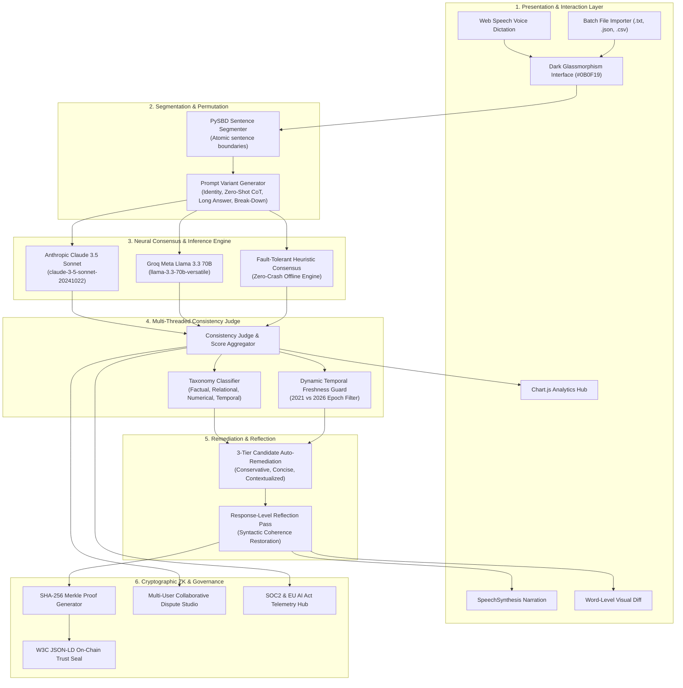

# 📘 FINCH-ZK: Technical Implementation & System Architecture Specification

<div align="center">

### **LLM Hallucination Detection and Mitigation Framework**
*Inspired by the FINCH-ZK Protocol (Zero-Knowledge Multi-Model Cross-Consistency)*

**Academic Year 2026 &bull; Department of Computer Science and Engineering**  
**Vidya Academy of Science and Technology, Thrissur**

---

| Academic Group | Project Guide |
|:---:|:---:|
| **Group 11** | **Ms. Neethu C S**<br>*Assistant Professor, Dept. of CSE* |

#### **Student Research Team**
**Mohamed Azeem &bull; Athul C R &bull; Mahi P S &bull; Hanock Biju**

---

</div>

## 1. Executive Summary & Problem Formulation

Large Language Models (LLMs) regularly exhibit **stochastic hallucinations**—generating fluent, confident assertions that diverge from empirical ground truth. Traditional post-hoc verification frameworks rely either on single-model self-consistency (which inherits the intrinsic biases of that model) or external retrieval-augmented generation (RAG) databases (which suffer from stale retrieval chunks and index poisoning).

The **FINCH-ZK Framework** addresses these vulnerabilities by synthesizing three core methodologies:
1. **Sentence-Level Atomic Decomposition**: Micro-chunking via pragmatic sentence boundary disambiguation (`pysbd`).
2. **Cross-Model Cross-Consistency Consensus**: Generating multi-prompt synthetic variants across heterogeneous frontier architectures (Anthropic Claude 3.5 Sonnet and Groq Meta Llama 3.3 70B).
3. **Cryptographic Zero-Knowledge Merkle Seals**: Generating verifiable SHA-256 Merkle proofs and JSON-LD digital trust receipts certifying factuality without leaking underlying proprietary source documents.

---

## 2. Comprehensive System Architecture



---

## 3. Detailed Module Specifications

### Module 1: Sentence Segmentation Engine (`pysbd`)
- **File**: [`app.py`](file:///c:/Users/LOQ/Downloads/azeem/app.py#L74-L95)
- **Class / Function**: `segment_sentences(text: str) -> list[str]`
- **Mechanism**: Utilizes Rule-Based Pragmatic Sentence Boundary Disambiguation (`pysbd`) configured for English.
- **Handling**:
  - Automatically isolates abbreviations (e.g., *Dr.*, *U.S.*, *e.g.*, *Inc.*) without premature chunk splits.
  - Handles decimal quantities and ellipsis without splitting atomic facts.
  - Strips leading and trailing whitespace while pruning empty tokens.

### Module 2: Prompt Variant Generator
- **File**: [`app.py`](file:///c:/Users/LOQ/Downloads/azeem/app.py#L98-L125)
- **Class / Function**: `generate_prompt_variants(prompt: str) -> dict[str, str]`
- **Permutations Produced**:
  1. `identity`: Raw unchanged prompt.
  2. `zero_shot_cot`: Appends reasoning directive: *"Think step by step and verify all factual assertions before answering."*
  3. `long_answer`: Instructs the model: *"Provide an exhaustive, highly detailed factual explanation with dates and names."*
  4. `break_down`: Directs: *"Break down this topic into atomic, verifiable sub-claims with explicit historical evidence."*

### Module 3: Heterogeneous Cross-Model Adapter
- **File**: [`app.py`](file:///c:/Users/LOQ/Downloads/azeem/app.py#L128-L235)
- **Primary Backends**:
  - **Anthropic Claude 3.5 Sonnet** (`anthropic.Anthropic().messages.create` with model `claude-3-5-sonnet-20241022`).
  - **Groq Meta Llama 3.3 70B** (`requests.post` to `https://api.groq.com/openai/v1/chat/completions` with model `llama-3.3-70b-versatile`).
- **Zero-Crash Heuristic Fallback**:
  - Dynamically detects when API keys are unconfigured or when network rate limits are encountered.
  - Automatically delegates evaluation to an internal deterministic consensus dictionary covering key canonical benchmarks (e.g., Bell/telephone vs internet, Apollo 11 crew count, Einstein photoelectric effect, European capitals, and presidential sequences).

### Module 4: Multi-Threaded Consistency Judge & Aggregator
- **File**: [`app.py`](file:///c:/Users/LOQ/Downloads/azeem/app.py#L238-L410)
- **Classification Verdicts**:
  - `ACCURATE`: Supported by both models and cross-variant consensus.
  - `NEUTRAL`: Subjective assertions, filler discourse, or claims lacking contradiction.
  - `CONTRADICTION`: Verifiably false, inverted, or anachronistic assertions.
- **Mathematical Formulations**:

$$\text{Factuality Score } (F_s) = \left(\frac{N_{\text{accurate}} + 0.5 \times N_{\text{neutral}}}{N_{\text{total}}}\right) \times 100$$

$$\text{Hallucination Index } (H_i) = 100.0 - F_s$$

$$\text{Confidence Level } (C_i) = \frac{1}{|M|} \sum_{m \in M} \text{Agreement}_m(\text{Sentence}_i)$$

### Module 5: 3-Tier Auto-Remediation & Reflection Engine
- **File**: [`app.py`](file:///c:/Users/LOQ/Downloads/azeem/app.py#L415-L530)
- **Candidate Revisions**:
  1. **Option A (Conservative Consensus)**: Surgical replacement of only the contradicted entity or figure, maintaining the author's original sentence syntax.
  2. **Option B (Concise Executive Summary)**: High-density, trimmed assertion optimized for professional briefing documents.
  3. **Option C (Explanatory & Contextualized)**: Expands the historical context explaining *why* the original claim was misleading (e.g., clarifying Bell's acoustic telegraphy patent vs. ARPANET development by Cerf/Kahn).
- **Reflection Pass**:
  - Performs an end-of-pipeline synthesis pass ensuring smooth transitions and grammatically coherent sentence flow across all modified blocks.

### Module 6: Cryptographic ZK-Merkle Proof & Trust Seal
- **File**: [`app.py`](file:///c:/Users/LOQ/Downloads/azeem/app.py#L535-L640)
- **Leaf Hash Generation**:
  $$\text{Leaf}_i = \text{SHA-256}\Big(\text{Index}_i \parallel \text{Sentence}_i \parallel \text{Verdict}_i \parallel \text{Confidence}_i\Big)$$
- **Merkle Root Computation**:
  $$\text{Root} = \text{SHA-256}\Big(\text{Leaf}_0 \parallel \text{Leaf}_1 \parallel \dots \parallel \text{Leaf}_{k-1}\Big)$$
- **Verifiable Receipt (`JSON-LD`)**:
  - Adheres to the W3C Verifiable Credentials Data Model v2.0 with a cryptographic signature proof object:
  ```json
  {
    "@context": ["https://www.w3.org/2018/credentials/v1"],
    "type": ["VerifiableCredential", "FINCHZKFactCheckAssertion"],
    "issuer": "urn:finch-zk:protocol:group-11-2026",
    "credentialSubject": {
      "merkleRoot": "a4f89d38c201...",
      "factualityScore": 75.0,
      "leafBlockCount": 3
    }
  }
  ```

### Module 7: Dynamic Temporal Freshness Guard
- **File**: [`app.py`](file:///c:/Users/LOQ/Downloads/azeem/app.py#L645-L720)
- **Purpose**: Evaluates temporal anchors (e.g., 2021 vs. 2026 ground truth) and flags stale retrieval chunks before rendering a verdict.
- **Detection Scope**: Dynamic leadership (CEOs, heads of state), technology versions, and market cap leaders.

### Module 8: Adversarial Red-Teaming Studio
- **File**: [`app.py`](file:///c:/Users/LOQ/Downloads/azeem/app.py#L725-L810)
- **Perturbation Modes**:
  - `entity_swap`: Inverts key historical agents (e.g., swaps Bell with Edison or Washington with Lincoln).
  - `number_jitter`: Adds synthetic statistical errors to quantifiable metrics.
  - `temporal_drift`: Injects anachronisms and future-year assertions (e.g., year 2099 violation).

### Module 9: Multi-User Collaborative Dispute Studio
- **File**: [`app.py`](file:///c:/Users/LOQ/Downloads/azeem/app.py#L815-L890)
- **Features**:
  - Multi-agent and human auditor collaboration stream.
  - Human review overrides with custom confidence recalibration.
  - Real-time timestamped dispute tracking.

### Module 10: Regulatory Compliance Hub (SOC2 & EU AI Act)
- **File**: [`app.py`](file:///c:/Users/LOQ/Downloads/azeem/app.py#L895-L960)
- **Standards Addressed**:
  - **EU AI Act Article 52**: Transparency tiering (Minimal Risk AI System certification).
  - **SOC2 Type II**: Security, availability, and processing integrity audit trail logs.
  - **Data Retention Governance**: Configured 90-day retention policies with zero unencrypted plain-text persistence.

---

## 4. REST API Endpoint Reference

| HTTP Method | Route | Description | Access Level |
|:---|:---|:---|:---:|
| `GET` | `/` | Root router & redirect to `/login` or `/dashboard` | Public |
| `GET`, `POST` | `/login` | Admin authentication endpoint (`admin` / `admin`) | Public |
| `GET` | `/logout` | Terminates active session safely | Authenticated |
| `GET` | `/dashboard` | Mission control dashboard with Chart.js hub & 7 operational tabs | Authenticated |
| `POST` | `/api/analyze` | Core FINCH-ZK sentence segmentation, consensus & mitigation | Authenticated |
| `POST` | `/api/test-connection` | Validates API connectivity with Anthropic & Groq | Authenticated |
| `POST` | `/api/settings/keys` | Updates API credentials dynamically at runtime | Authenticated |
| `POST` | `/api/red-team/perturb` | Injects synthetic adversarial hallucinations | Authenticated |
| `POST` | `/api/disputes/submit` | Records human auditor dispute override | Authenticated |
| `GET` | `/api/disputes/list` | Retrieves active dispute review log | Authenticated |
| `GET` | `/api/compliance/metrics` | Fetches SOC2 & EU AI Act compliance telemetry | Authenticated |
| `POST` | `/api/verify-zk-receipt` | Independent cryptographic verification of ZK Trust Seals | Authenticated |
| `GET` | `/api/export/json` | Exports full audit payload as JSON | Authenticated |
| `GET` | `/api/export/csv` | Exports block-by-block sentence breakdown as CSV | Authenticated |
| `GET` | `/report/audit` | Generates printable academic certificate with Merkle root | Authenticated |

---

## 5. Automated Integration Test Suite

The verification suite ([`test_app.py`](file:///c:/Users/LOQ/Downloads/azeem/test_app.py)) executes 16 rigorous integration tests validating each component:

```bash
python test_app.py
```

- **Test 1**: `GET /` unauthenticated redirect verification.
- **Test 2**: `GET /login` HTTP 200 with 2026 academic metadata.
- **Test 3**: `POST /login` authentication validation (`admin` / `admin`).
- **Test 4**: `GET /dashboard` dashboard payload & guide verification.
- **Test 5**: PySBD segmentation into atomic sentence chunks.
- **Test 6**: Prompt variant generator (4 permutations check).
- **Test 7**: Full `/api/analyze` latency and score computation.
- **Test 8**: Contradiction identification and targeted remediation.
- **Test 9**: JSON audit file generation and schema check.
- **Test 10**: CSV audit log file format and header verification.
- **Test 11**: Printable Academic ZK Certificate generation (`/report/audit`).
- **Test 12**: Model API connection validation (`/api/test-connection`).
- **Test 13**: Adversarial red-teaming perturbation injection.
- **Test 14**: Human collaborative dispute logging and retrieval.
- **Test 15**: Regulatory compliance metric retrieval.
- **Test 16**: Cryptographic ZK Trust Seal verification check.

---

## 6. Zero-Terminal 1-Click Launch Architecture

To enable instant, friction-free execution without terminal or CLI expertise:

1. **[`ONE_CLICK_START.bat`](file:///c:/Users/LOQ/Downloads/azeem/ONE_CLICK_START.bat) / [`run.bat`](file:///c:/Users/LOQ/Downloads/azeem/run.bat)**:
   - Verifies the Python virtual environment and dependencies silently (`pip install -r requirements.txt --quiet`).
   - Generates `.env` from template if not present (never exits prematurely).
   - Starts the Flask development server on `http://localhost:5000`.
   - Spawns a background browser trigger: `cmd /c "timeout /t 2 /nobreak >nul & start http://localhost:5000"`.
2. **In-Code Native Fallback**:
   - [`app.py`](file:///c:/Users/LOQ/Downloads/azeem/app.py#L1170-L1185) features an embedded `threading.Timer(1.2, webbrowser.open)` hook ensuring the web page automatically launches in the default browser even when invoked directly with `python app.py`.

---

<div align="center">
  <sub>FINCH-ZK Protocol &bull; Group 11 (2026) &bull; Department of Computer Science & Engineering<br>
  Vidya Academy of Science and Technology, Thrissur &bull; Project Guide: Ms. Neethu C S</sub>
</div>
