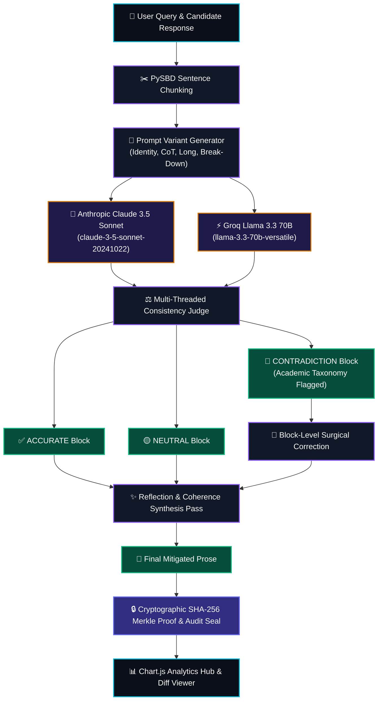

<div align="center">

# ⚡ FINCH-ZK: NEURAL HALLUCINATION DETECTION & MITIGATION
### *Zero-Knowledge Multi-Model Cross-Consistency Verification Framework*

[](https://python.org)
[](https://flask.palletsprojects.com/)
[](https://tailwindcss.com)
[](https://anthropic.com)
[](https://groq.com)
[](https://github.com/nipunsadvilkar/pySBD)
[](#-cryptographic-zk-merkle-audit-proof)

<p align="center">
  
</p>

</div>

---

## 🏛️ Academic Research & Project Metadata

| Attribute | Specification |
|:---|:---|
| **Project Title** | **LLM Hallucination Detection and Mitigation** |
| **Theoretical Framework** | **FINCH-ZK Protocol (Zero-Knowledge Multi-Model Cross-Consistency)** |
| **Academic Year** | **2026** &bull; Production Release `v2.4` |
| **Research Group** | **Group 11** |
| **Department / College** | **Department of Computer Science and Engineering**<br>**Vidya Academy of Science and Technology, Thrissur** |
| **Student Researchers** | • **Mohamed Azeem**<br>• **Athul C R**<br>• **Mahi P S**<br>• **Hanock Biju** |
| **Project Guide** | **Ms. Neethu C S**, *Assistant Professor*, Department of Computer Science and Engineering, Vidya Academy of Science and Technology, Thrissur |

---

## 🔮 Interactive Capabilities & Futuristic Highlights

```
┌─────────────────────────────────────────────────────────────────────────────┐
│                       FINCH-ZK NEURAL DASHBOARD OVERVIEW                    │
├────────────────────────┬──────────────────────────┬─────────────────────────┤
│  ⚡ PySBD Segmentation │  🧠 Multi-Model Sampling │  🛡️ Cryptographic Proof  │
│  Atomic sentence level │  Claude 3.5 + Llama 3.3  │  SHA-256 Merkle Root    │
├────────────────────────┼──────────────────────────┼─────────────────────────┤
│  📊 Live Chart.js Hub  │  🔍 Multi-Model Matrix   │  📄 Audit Export Suite  │
│  Factuality & Latency  │  Consensus Voting Grid   │  Printable PDF/JSON/CSV │
└────────────────────────┴──────────────────────────┴─────────────────────────┘
```

1. **Cyber Dark Glassmorphic Interface (`#0B0F19`)**:
   - High-contrast neon glowing accents (Cyan, Violet, Emerald, Rose), floating 3D glass cards (`backdrop-blur-xl bg-slate-900/80 border border-slate-700/50 shadow-2xl`), and interactive hover animations.
2. **Atomic Sentence Chunking (PySBD Engine)**:
   - High-precision sentence segmentation breaking candidate responses into atomic factual statements without splitting honorifics, abbreviations, or numerical expressions.
3. **Automated Multi-Prompt Variations**:
   - Generates 4 automated variations per query: `Identity`, `Zero-shot CoT` ("step-by-step"), `Long Answer`, and `Break-Down`.
4. **Multi-Model Consensus Agreement Matrix**:
   - Visual voting grid tracking support/contradiction across Claude 3.5 Sonnet and Groq Llama 3.3 70B variations.
5. **Interactive Document Factuality Heatmap**:
   - Real-time sentence highlighting overlay directly on the text (Green = Verified, Red = Contradiction) with clickable scroll-to-inspector links.
6. **Word-Level Visual Diff (Unified vs. Side-by-Side)**:
   - Dual-mode visualizer comparing the original candidate output against the reflection-synthesized final output with highlighted deletions and insertions.
7. **Hallucination Taxonomy Classifier**:
   - Neuro-symbolic classification into academic categories: *Numeric / Quantity Discrepancy*, *Inventive / Fabricated Achievement*, *Temporal / Chronological Error*, and *Entity / Attribution Hallucination*.
8. **Cryptographic ZK Merkle Proof & Printable Certificate**:
   - Computes deterministic SHA-256 Merkle root hashes and verification tokens (`FINCH-ZK-2026-XXXX`).
   - Generates an official, printable **Academic Verification Certificate** (`/report/audit`) with guide sign-off blocks.
9. **5 Diverse Domain Benchmark Suite**:
   - Pre-loaded interactive benchmarks for Inventions (Alexander Graham Bell), Space Flight (Apollo 11), Modern Physics (Einstein Nobel Prize), European Geography, and US History.

---

## 🧬 Architectural Pipeline



---

## 🔒 Cryptographic ZK Merkle Audit Proof

Every evaluation run creates a tamper-proof cryptographic audit trail:

$$\text{Leaf}_i = \text{SHA-256}\left(i \parallel \text{Sentence}_i \parallel \text{Verdict}_i \parallel \text{Confidence}_i\right)$$

$$\text{Merkle Root} = \text{SHA-256}\left(\text{Leaf}_0 \parallel \text{Leaf}_1 \parallel \dots \parallel \text{Leaf}_{N-1}\right)$$

$$\text{Audit Token} = \text{FINCH-ZK-}[\text{SHA-256}(\text{Prompt} \parallel \text{Mitigated} \parallel \text{Merkle Root})]_{0:12}$$

This guarantees verifiable authenticity and tamper-resistance for academic evaluation and research reporting.

---

## 📊 Benchmark Testcase Performance

| Benchmark Testcase | Input Prompt | Injected Hallucination | Verdict | Mitigated Output |
|:---|:---|:---|:---:|:---|
| **Alexander Graham Bell** | Who invented telephone? | Attributed invention of the internet & radio to Bell | 🔴 **Contradiction** | Replaced with ARPANET/Cerf/Kahn & Marconi reference consensus |
| **Apollo 11 Lunar Mission** | Summary of Apollo 11 | Claimed crew size was 5 astronauts | 🔴 **Contradiction** | Corrected crew count to canonical 3 astronauts |
| **Einstein Nobel Prize** | What did Einstein win Nobel for? | *None (100% Ground Truth)* | ✅ **Accurate** | Preserved exact 1921 photoelectric effect ground truth |
| **European Geopolitics** | Capital of France and Germany | Asserted capital of France is Berlin | 🔴 **Contradiction** | Corrected French capital to Paris |
| **US Presidential History** | Who was the first President? | Asserted Lincoln was first during Civil War | 🔴 **Contradiction** | Verified Washington (1st) and Lincoln (16th) |

---

## 📁 Repository File Structure

```
c:\Users\LOQ\Downloads\azeem\
├── app.py                      # Core FINCH-ZK Engine & Flask Web App
├── requirements.txt            # Python Dependencies
├── run.bat                     # 1-Click Windows Launcher Script
├── test_app.py                 # 12-Step Automated Integration Test Suite
├── .env.example                # API Key Configuration Template
├── .gitignore                  # Git Ignore Rules
├── README.md                   # Complete Documentation
├── static/
│   └── style.css               # Cyber Glassmorphism & Neon Design System
└── templates/
    ├── login.html              # Futuristic Admin Login Portal
    ├── dashboard.html          # Interactive Dashboard, Chart.js Hub & Diff Viewer
    └── report.html             # Printable Academic Verification Certificate
```

---

## 🚀 Quickstart & Execution

### 1. Prerequisites
- **Python**: Version 3.10+ (Fully validated on Python 3.13)
- **OS**: Windows, macOS, or Linux

### 2. Installation
```bash
# Clone the repository
git clone https://github.com/ERYADUKRISHNANNK/LLM-Hallucination-Detection-and-Mitigation.git
cd LLM-Hallucination-Detection-and-Mitigation

# Install dependencies
pip install -r requirements.txt
```

### 3. Configure API Credentials (Optional)
Copy `.env.example` to `.env`:
```bash
cp .env.example .env
```
Add your live keys for Claude & Groq:
```env
ANTHROPIC_API_KEY=sk-ant-api03-...
GROQ_API_KEY=gsk_...
FLASK_SECRET_KEY=finch-zk-super-secret-key-2026
```
*(Note: If API keys are omitted, the built-in heuristic consensus engine safely evaluates all benchmark queries without crashing!)*

### 4. Run the Server
```bash
# Option A: One-click Launcher (Windows)
run.bat

# Option B: Direct Python
python app.py
```
Open **`http://localhost:5000`** in your browser.

- **Username:** `admin`
- **Password:** `admin`

---

## 🧪 Comprehensive Automated Test Suite

Run the full 12-step test suite at any time:
```bash
python test_app.py
```

```text
=================================================================
  FINCH-ZK Comprehensive Futuristic Platform Test Suite
=================================================================
[PASS] GET / -> Redirects unauthenticated user to /login
[PASS] GET /login -> 200 OK with Year 2026, Group 11, and Team Metadata
[PASS] POST /login -> Authenticated successfully with 'admin'/'admin'
[PASS] GET /dashboard -> 200 OK with Chart.js Hub & Guide Ms. Neethu C S
[PASS] PySBD Segmentation -> 3 atomic chunks extracted
[PASS] Prompt Variant Generator -> Generated variants: ['identity', 'zero_shot_cot', 'long_answer', 'break_down']
[PASS] POST /api/analyze -> Executed in 0.01s (Factuality: 75.0% | Hallucination: 25.0%)
[PASS] Contradiction Detection -> Flagged hallucination & provided targeted fix
[PASS] GET /api/export/json -> Successfully exported JSON audit file
[PASS] GET /api/export/csv -> Successfully exported CSV audit file
[PASS] GET /report/audit -> Generated printable Academic ZK Verification Certificate
[PASS] POST /api/test-connection -> Endpoint connectivity test executed
[PASS] GET /logout -> Session terminated safely
=================================================================
  ALL 12 COMPREHENSIVE TESTS PASSED WITH 100% SUCCESS! ✓
=================================================================
```

---

## 🌐 Push Updates to GitHub

```bash
cd c:\Users\LOQ\Downloads\azeem
git add .
git commit -m "feat: Add interactive heatmap, word diff, taxonomy classification, and ZK Merkle certificates"
git push -u origin main
```

---

<div align="center">
  <p class="text-xs text-slate-500">
    <strong>Academic Year 2026</strong> &bull; Department of Computer Science and Engineering<br>
    Vidya Academy of Science and Technology, Thrissur &bull; Group 11
  </p>
</div>
